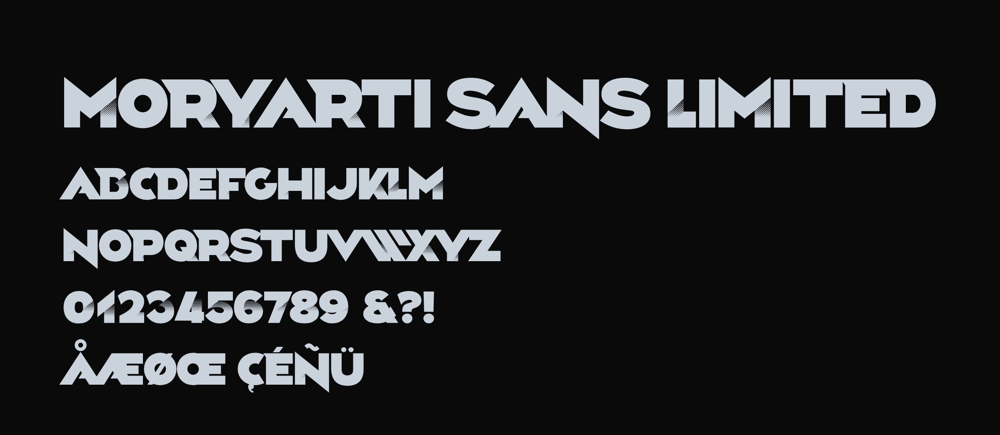

# Moryarti Sans Limited



A display typeface from the MORYARTI inc. logotype: heavy geometric capitals with a halftone shadow.
Capitals only (lowercase input sets the same forms). Figures 1–5 carry the halftone; `ss01` gives solid 1, 3 and 5.

## Build

The fonts are built from `sources/MoryartiSansLimited.glyphs` with the Google Fonts builder:

```bash
pip install -r requirements.txt
gftools builder sources/config.yaml     # → fonts/ttf/MoryartiSansLimited-Regular.ttf, fonts/webfonts/MoryartiSansLimited-Regular.woff2
fontbakery check-googlefonts fonts/ttf/*.ttf
```

## Web

```css
@font-face{font-family:"Moryarti Sans Limited";src:url(MoryartiSansLimited-Regular.woff2) format("woff2");font-weight:400;font-display:swap}
.figures-solid{font-feature-settings:"ss01" 1}      /* 1 3 5 without halftone */
```

## Notes

- Metrics: UPM 4000, cap height 2953. Typo = hhea: ascender 3977 / descender −1024 / line gap 0 (USE_TYPO_METRICS): capitals
  centred in the line, 125% of the UPM, after the Google Fonts vertical-metrics guide. Win 4277 / 1420 (the font's extremes).
- Halftone rules: `docs/halftone-rules.md`. Google Fonts readiness: `docs/google-fonts-status.md`.

## Licence

This Font Software is licensed under the SIL Open Font License, Version 1.1 (`OFL.txt`).
